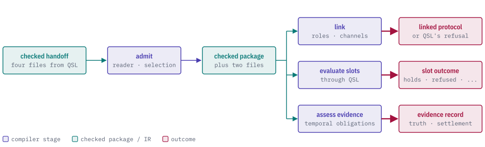
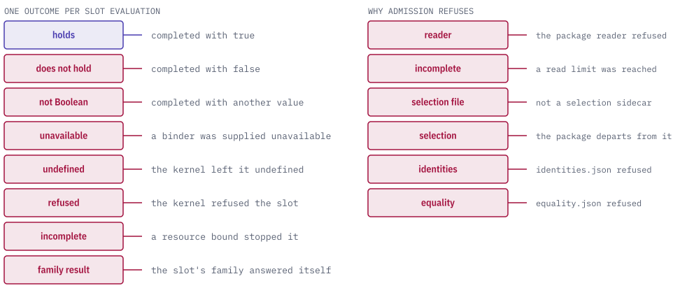

# quire-protocol

[](https://discord.gg/k8DVhuYBR2)

quire-protocol is a Rust crate that checks recorded traffic against a compiled
protocol. A protocol describes roles that exchange messages over channels,
together with the steps that undo earlier work when something fails.

The crate takes a protocol compiled by the Quire Specification Language (QSL)
and a finite record of observations. It reports whether the traffic followed the
protocol and whether the undo path is available, using a closed vocabulary: a
missing observation is "incomplete", a conversation that may still advance is
"pending", and only an adverse observation is a "violation". Layers above it
use these results and do not read protocol files.

<picture>
  <source media="(prefers-color-scheme: dark)" srcset="docs/images/hero-dark.svg">
  
</picture>

> **Status: prerelease, private repository.** The pieces below exist and are
> tested. They are not yet joined into one end-to-end pipeline, the crate is not
> published (`publish = false`), and no qualification claim exists. Expect
> breaking changes.

## Features

- **Reads compiled protocols strictly.** It accepts QSL's
  `quire.compiled-protocol/1` and `/2` handoffs through the exact QSL readers.
  You choose the version by choosing the module. The version-1 and version-2
  readers refuse each other's files and do not translate them.
- **Selects independently.** The caller names the artifact, its dependency
  closure, profile and version-lock entries. A producer's own statement of what
  it emitted is evidence only.
- **Links.** Admission and linking are separate steps. Linking builds this
  crate's own finite linked representation of the protocol, which is separate
  from QSL's, and reports problems with locations.
- **Assesses compensation.** It works out from the reported facts whether
  compensation is active, registered, ordered correctly, retried within its
  bound and recovered. Attempts and effects stay distinct, and no business
  action is executed.
- **Checks conformance.** A bounded batch replay and an incremental mode give
  each obligation its own disposition. The incremental mode gives the same
  answer as the batch once the record settles.
- **Produces a canonical result.** The result record is
  `quire.protocol.result/v1-draft.1`, with a strict reader, and it projects
  into the `quire-verification/e02-draft-2` evidence format.

## Outcomes

Each obligation in a protocol ends in exactly one disposition. A violation
names the adverse observation behind it.

<picture>
  <source media="(prefers-color-scheme: dark)" srcset="docs/images/outcomes-dark.svg">
  
</picture>

The whole run gets one aggregate status: conforms, pending, violates or
unavailable. The per-obligation results remain visible beneath it. Missing or
duplicate premises are reported as their own defects and cannot change an
obligation's result. Compensation availability is reported separately, as
either available or unavailable with the list of causes. Causes include no
activation fact, an ordering violation, a retry bound exceeded, and a recovery
decision not yet reported.

Operations return one of three outcomes: completed, refused with a typed
refusal, or resource-incomplete when a declared bound (counts, allocation or
deadline) stopped the work. Exhausting a bound is not reported as a refusal or a
violation.

## Admitting a protocol

Admission takes the offered bytes, what the caller independently expects, and
resource limits. The following version-2 case is from
[`tests/it001_v2_handoff.rs`](tests/it001_v2_handoff.rs), which runs QSL's
published handoff through admission:

```rust
let loaded = configured();
let declarations = loaded.declarations();
let inventories = loaded.inventories(&declarations);
let expected = loaded.expected(&inventories);

let report = quire_protocol::intake::v2::admit(loaded.offer(), &expected, loaded.limits());
match report.result() {
    Ok(package) => {
        assert_eq!(package.digest(), loaded.reference().digest);
        assert_eq!(package.package().inherited.wire, v2::WIRE);
        assert_eq!(
            package.package().temporal_bindings.len(),
            loaded.selection().temporal.len()
        );
    }
    Err(error) => panic!(
        "the published handoff was refused with {}: {error}",
        handoff::reported_code(error)
    ),
}
```

`configured()` and the other helpers load the handoff fixtures in
[`tests/support`](tests/support). The compensation path has runnable examples in [`tests/tc_003_compensation.rs`](tests/tc_003_compensation.rs).

## Modules

| Module | What it holds |
| --- | --- |
| `intake` | Version-explicit admission: `intake::v1` and `intake::v2`. The root `admit_and_link` is a narrow `/1` compatibility facade. |
| `inventory`, `version_lock` | The independently selected inventory and version-lock resolution that admission is checked against. |
| `link` | The finite linked-protocol graph and its located diagnostics. |
| `model` | Version-explicit full-assessment models. |
| `compensation` | Activation, registration, ordering, retry, recovery and the composed snapshot. |
| `conformance` | Batch and settled-incremental conformance. |
| `closure`, `outcome` | The five-axis closure and the closed operation and claim outcomes. |
| `claims` | Independent claim dispositions. |
| `bounds` | Count, allocation and deadline guards. |
| `digest`, `result` | Digest domains and the canonical protocol result. |
| `projection` | The projection of a result into `quire-verification/e02-draft-2`. |
| `refusal` | The typed refusal envelope and its catalogue. |
| `repro`, `delivery_index`, `producer_contracts` | Reproduction record, evidence index for one pinned delivery, and the producer-contract inventory. |

The crate has one feature, `test-support`, which exposes validated-result
constructors for a dependent crate's own tests. Enable it only on a
`[dev-dependencies]` entry; the default build exposes none of it.

## Out of scope

QSL owns native grammar, parsing and compiler diagnostics. Other repositories
own temporal-logic syntax and evaluation, observation collection and
correlation, running compensation or business actions, evidence storage,
verification-method catalogs and sufficiency decisions, and release policy. The
normative contracts live in quire-specification (private), and
the intended architecture is in
[`spec/assurance/AD-001-protocol-library-boundaries.md`](spec/assurance/AD-001-protocol-library-boundaries.md).
Start from [`spec/spec.md`](spec/spec.md) for the requirements.

## Quire ecosystem

`quire-protocol` is one of the backends. It reads checked output from the
language layer and works over observations. It sits above QSL and below the
orchestration tools.

<picture>
  <source media="(prefers-color-scheme: dark)" srcset="docs/images/ecosystem-dark.svg">
  
</picture>

It depends on [quire-spec-language](https://github.com/agent-ix/quire-spec-language)
(the compiled-protocol readers and their `handoff-writer` test producer),
[quire-observation](https://github.com/agent-ix/quire-observation) (qualified
observation values),
[quire-verification-contracts](https://github.com/agent-ix/quire-verification-contracts)
(the evidence format it projects into) and
[engineering-assurance](https://github.com/agent-ix/engineering-assurance) (the
claim-strength vocabulary), all pinned by Git revision in `Cargo.toml`.
[quire-contract-ir](https://github.com/agent-ix/quire-contract-ir) is a
dev-dependency used only by tests.

## Building and testing

All first-party code and tests are Rust. The local gate is seven commands run in
order over one unchanged head, defined by
[`spec/non-functional/NFR-004-define-local-verification-gate.md`](spec/non-functional/NFR-004-define-local-verification-gate.md)
and listed in [`AGENTS.md`](AGENTS.md): `cargo fmt --check`, clippy with
warnings denied, tests and rustdoc in the default lane, then clippy, tests and
rustdoc again in the `test-support` lane. Tests bind to requirements with
`ix-trace-rs` attributes. No hosted CI runs from this repository.

## Contributing

Read [`CONTRIBUTING.md`](CONTRIBUTING.md) first. Every contribution needs a
signed [CLA](CLA.md). Contributor rules are in [`AGENTS.md`](AGENTS.md), and the
artifact and rights policy is in [`ARTIFACTS.md`](ARTIFACTS.md).

## License

AGPL-3.0-or-later. See [`LICENSE`](LICENSE) and
[`LICENSE-DECISION.md`](LICENSE-DECISION.md).
