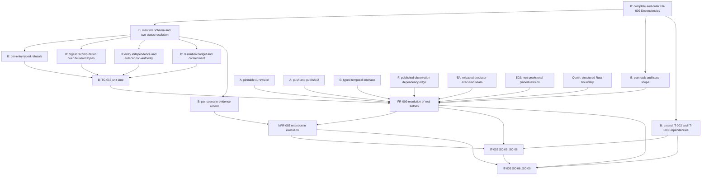

## Summary

This review separates enablement from feature work across the whole external
producer set the packet locks, and checks every external interface the packet
names against the repository that owns it. Every packet file was re-read at its
current on-disk state, after the revision that gave FR-009 its resolution-status
model, resolution budget and containment clause and redivided the integration
scenarios; `spec/tests.md` was not revised with them and is now stale against
the criteria and scenarios it indexes. The B-owned half of FR-009 — manifest parsing,
per-axis typed refusal, digest recomputation over delivered bytes, entry
independence and sidecar non-authority — is enablement that needs no external
delivery and is runnable today, yet `spec/tests.md` still records FR-009 as
gated on external acceptance, and the TC-013 the revised criteria now name does
not exist. The external half does not hold: of the seven producers FR-009's
Inputs enumerate, none is pinnable to a revision its owner has actually
published, so the manifest's immutability assertion has no truthful value for
any entry, not only for the `/2` entry the packet declares unresolved.

## Findings

| ID | Severity | Summary | Refs | Escape Cause |
| --- | --- | --- | --- | --- |
| FND-001 | high | IT-003's Preconditions assert four acceptances and none survives verification. Engineering Assurance's `producer_execution` seam is merged on `origin/main` but `publish = false`, and no tag (`v0.2.0`..`v0.3.1`) or release contains `src/producer_execution.rs`; the acceptance SHA `f640f4c` is not reachable from that repository's `origin/main` after PR #46 was squashed, and issue #34's own bar — cross-repository consumer evidence before either side claims the seam accepted — records no returned TC-126 result even though the issue is now closed. quire-verification has zero tags and zero releases, `docs/interface-decision.md` declares the E02 interfaces "provisional across repositories" pending E01/FS02/FS05, `spec/spec.md` marks FR-007 "Specified; Rust pending", and the code sits on `agent-b/e02-compatibility-contracts` rather than main. Quoin exposes no Rust-callable structured boundary at all — `src/evidence/` and `src/commands/evidence/` are TypeScript and the repository contains no `Cargo.toml` — and `quire-research#62`, the containment contract that would define one, is OPEN with every acceptance box unchecked. | IT-003 Preconditions; IT-003 Dependencies; FR-009 Inputs; engineering-assurance `src/producer_execution.rs`, `Cargo.toml`; quire-verification `docs/interface-decision.md`, `spec/spec.md`; quoin `package.json`, `src/evidence/`; quire-research#62 | wrong-requirement |
| FND-002 | high | The revised manifest turns publication into the owner's own assertion, and no owner can make that assertion truthfully today. An entry now carries "the owner's own assertion that the revision is immutable and published", which the library is forbidden to check — but FR-009's own Self-authorization clause refuses an offer that supplies its own acceptance context, and this is that shape with the sidecar removed. The assertion also has no true value anywhere in the live set: quire-spec-language has no tags and no releases at all, and this crate's only non-dev pin, `quire-spec-language rev = 5690c2b2` in `Cargo.toml`, is not an ancestor of A's `origin/main` (`72507f8`) and is contained only by `origin/agent-a/handoff-numeric-domains`; Engineering Assurance has released no revision containing the seam; quire-verification has no tags. The packet declares exactly one entry `unresolved`, the A `/2` entry, when on the evidence at least the A `/1`, Engineering Assurance and E02 entries are in the same state. | FR-009 Inputs; FR-009 Resolution; FR-009 Self-authorization; FR-009 Dependencies; `Cargo.toml`; quire-spec-language `origin/main` `72507f8`; SR-040 FND-002 | wrong-requirement |
| FND-003 | high | FR-009's Dependencies names one of the seven external gates it depends on. Its own Inputs enumerate the A-owned compiled-protocol contract at each published version, the E temporal profile, the F observation and output-mapping contracts, the PT02 closure record, the Engineering Assurance producer-execution seam, the E02 strict reader and the Quoin evidence interface. Dependencies names only the A `/2` entry, alongside four local ownership notes for FR-001, FR-008, NFR-002 and NFR-003. A `/1`, E, F, PT02, Engineering Assurance, E02 and Quoin carry no gate, so the requirement whose whole purpose is to make external dependence explicit leaves six of seven dependencies implicit. `spec/spec.md` §16 References compounds it: quire-spec-language, the F observation contracts and Quoin appear nowhere in the repository's own external reference index. | FR-009 Inputs; FR-009 Dependencies; spec/spec.md §16 | missing-requirement |
| FND-004 | high | The delivery order among the gates is still unstated, and the one ordering statement the revision added is about something else. FR-009 now declares that the manifest carries no dependency between entries "so resolution needs no order and can contain no cycle" — a true and useful property of resolution at run time, which says nothing about the order in which the gates must close. That order is strict: the manifest schema and its resolution and refusal behaviour precede any entry, an owner's publication precedes that owner's entry moving from `unresolved` to `pinned`, every required entry precedes the scenarios that read a producer value behind it, and FR-009's resolution state precedes NFR-005's per-scenario record, which cannot retain a state that does not yet exist. Absent that, Dependencies reads as satisfiable while the boundary is still moving, exactly as SR-040 FND-008 recorded for IT-001's six A deliverables. | FR-009 Dependencies; FR-009 Entry identity and independence; NFR-005 Dependencies; IT-002 Preconditions; IT-003 Preconditions; SR-040 FND-008 | missing-requirement |
| FND-005 | high | The packet invents an external gate over work B already delivered. FR-009's Inputs list "the PT02-owned complete-global-conformance closure record" as an external producer, and IT-002's Objective, owner-boundary table, Task-010 and issue #12 carry the same attribution. The record is B-authored and merged: quire-specification `spec/functional/FR-061-report-orthogonal-results.md` and `FR-059-assess-finite-global-conformance.md` landed through PR #22 from `agent-b/global-conformance-closure`, and the F output-mapping contract attributes the fifth closure record to B in its own text. `quire-research#48` (PT02) is an OPEN research ticket with every acceptance box unchecked whose body names quire-protocol itself as the intended implementation home, and the string "complete-global-conformance" appears nowhere in quire-research. A manifest entry for PT02 can never resolve, because there is no external owner to assert anything about it. | FR-009 Inputs; IT-002 Objective; IT-002 owner boundaries; Task-010 Scope; issue #12; quire-research#48; quire-specification FR-061, PR #22 | wrong-requirement |
| FND-006 | high | No plan task and no issue acceptance box owns the eight new scenarios or the two new requirements. Plan-001's Dependency Graph, exit criteria and coverage table name neither FR-009 nor NFR-005, and its exit criteria stop at "IT-002 SC-01..SC-04" and "IT-003 SC-01..SC-05". Task-010's and Task-011's subtasks stop at the same scenarios, as do the acceptance lists of issues #12 and #13. IT-002-SC-05..SC-08 and IT-003-SC-06..SC-09 are authored scope with no owning task, repeating the condition SR-040 FND-007 recorded for IT-001's `/2` lane. | Plan-001 Dependency Graph, exit criteria, coverage table; Task-010 Subtasks; Task-011 Subtasks; issue #12; issue #13; SR-040 FND-007 | missing-requirement |
| FND-007 | high | Every revised FR-009 criterion verifies through `TC-013`, and TC-013 does not exist: `spec/test-cases/` runs TC-001 through TC-012 with no gap. All seven criteria therefore name a non-existent verification owner, and `spec/tests.md` was not revised with the requirement — its FR-009 row still lists AC-1 through AC-5 against the new AC-1 through AC-7, still names only IT-002 and IT-003 as the tests, and still records FR-009 as "integration-owned; no TC companion, so FR-009 completion is gated on the external producer acceptance both integrations wait on". AC-7's second owner, TC-010, is likewise absent from that row. The scenario identifiers moved too — IT-002 now runs SC-05a..SC-05d, SC-07a and SC-07b, IT-003 runs SC-08a and SC-08b — while the matrix still records flat ranges "SC-01..SC-08" and "SC-01..SC-09", so it cannot count the scenarios either integration owes. The Test Matrix and the packet now disagree about the count of criteria, the count of scenarios, and who verifies them. | FR-009-AC-1..AC-7; spec/test-cases/; spec/tests.md FR-009, NFR-005, IT-002 and IT-003 rows; IT-002-SC-05a..SC-07b; IT-003-SC-08a, SC-08b; TC-010 | missing-requirement |
| FND-008 | high | Both integrations gained owners in this packet without gaining the matching gates. IT-002's owner-boundary table now carries Engineering Assurance, for the bounded execution context and the budget each scenario is granted, and Quoin, for retention of the scenario evidence record after handoff — but IT-002's Dependencies section still names only F's FR-115/FR-116, TC-145/TC-146, IT-051 and output-mapping contract plus the E temporal profile, and asks nothing of either new owner. IT-003's table now carries A, for the admitted package the canonical result derives from at one explicit contract version, while its Dependencies names only Engineering Assurance, quire-verification, Quoin and `quire-research#62`. Three owners whose absence blocks the scenarios sit in the boundary tables with no stated gate, so neither integration's Dependencies enumerates what it actually waits on. | IT-002 owner boundaries; IT-002 Dependencies; IT-003 owner boundaries; IT-003 Dependencies | missing-requirement |
| FND-009 | medium | FR-009's declared edge points the wrong way and closes a loop in the graph `spec-to-plan` consumes. Its frontmatter declares `depends_on FR-001`, while AD-001's amended System Boundary says the repository "begins at resolution of its external producers through one version-lock manifest, then at strict consumption of a compiled, versioned native protocol artifact", and FR-009's Resolution clause requires resolution before any producer value is read for that integration. FR-009's own Dependencies prose agrees with AD-001 and so contradicts its own frontmatter, and FR-001 remains gated on the admitted producer the manifest resolves. The corrected edge is FR-009 to FR-001. | FR-009 frontmatter `depends_on FR-001`; FR-009 Resolution; FR-009 Dependencies; AD-001 System Boundary; Plan-001 Dependency Graph | wrong-requirement |
| FND-010 | medium | IT-002's Target Integration states "The producers are accepted observation and temporal Rust interfaces"; half of that is unsupported. Observation is a real Rust crate — `quire-observation` `src/handoff.rs` carries `ScopeFact` for all four decision-scope and surrounding-execution axes plus `GlobalConformanceClosure`/`GlobalClosureState` at `PRODUCER_INTERFACE_VERSION = "1.2.0"` — but it is `publish = false` and this crate's `Cargo.toml` declares no dependency on it, so there is no dependency edge to pin. Temporal has no Rust interface at any state: E's contribution is merged prose in quire-specification (FR-090..FR-092, FR-095 and the `proposals/quire-v1/definitions/temporal-*` set, PRs #17/#20/#23), while the quire-contract-ir temporal branches are not ancestors of its `origin/main` and PRs #65..#68 are all OPEN. FR-009 cannot pin a typed temporal producer that does not exist. | IT-002 Target Integration; IT-002 Dependencies; FR-009 Inputs; quire-observation `Cargo.toml`, `src/handoff.rs`; quire-protocol `Cargo.toml`; quire-contract-ir PRs #65..#68 | wrong-requirement |
| FND-011 | medium | "Manifest" now names two artifacts with opposite trust rules and nothing distinguishes them. `tests/support/v2/mod.rs` already defines `MANIFEST_FILE = "b-v2-manifest.json"` and a `Manifest` struct carrying `producer_revision`, read from a delivery root and reported as `Absence::MissingManifest` when absent — a producer-populated file B reads. FR-009-AC-4 requires that no producer-emitted file can supply, select or repair an entry. The existing loader is the shape that criterion forbids, and no text in the packet says whether the delivery manifest feeds the version-lock manifest, is superseded by it, or is a separate artifact needing a different name. | FR-009-AC-4; `tests/support/v2/mod.rs` `MANIFEST_FILE`, `Manifest`, `Absence::MissingManifest`; `tests/it001_v2_intake.rs` | missing-requirement |
| FND-012 | medium | NFR-005's prerequisites exist only in prose. Its Dependencies names FR-009, FR-008, NFR-002, NFR-001 and NFR-003, while its frontmatter declares `constrains` edges to FR-009, FR-006 and FR-008 only. The NFR-002 budget figures AC-4 cannot be satisfied without, NFR-001's reproducibility constraint on the retained evidence, and NFR-003's containment of the handoff are all absent from the machine-readable graph, while FR-006 is present in it and absent from the prose. Any consumer of the relationship graph sequences NFR-005 wrongly. | NFR-005 frontmatter; NFR-005 Dependencies; NFR-005-AC-4; NFR-002; NFR-001; NFR-003 | wrong-requirement |
| FND-013 | medium | The B-owned half of FR-009 is enablement and is scheduled as though it were externally gated. Manifest parsing, the two-status resolution model, per-axis typed refusal, digest recomputation over exact delivered bytes, proving one entry's change moves no other, proving a removed sidecar changes no outcome, and the resolution budget are B-owned logic requiring no producer at all, testable today against B fixtures exactly as the `/2` evidence loader already is. No manifest artifact exists anywhere in the tree, so the resolution mechanism every new scenario presumes is unbuilt; scheduling it behind seven external acceptances leaves the integrations with nothing to resolve against and inverts the rule that enablement is tasked before the features depending on it. SR-049 FND-002 records the same absence from the evidence side. | FR-009-AC-1..AC-7; NFR-005-AC-1..AC-5; spec/tests.md FR-009 and NFR-005 rows; SR-049 FND-002 | correct-requirement-no-evidence |
| FND-014 | low | IT-002's Notes overstate the reach of the pinned F revision. It says commit `d8d984b5` "now specifies the required independent decision-scope and surrounding-execution progress/closure axes plus the complete-global-conformance closure record and premise mutations through both F consumer paths". The commit exists in quire-specification and is an ancestor of its `origin/main` through merged PR #15, but it touches exactly two files, FR-116 and TC-146, and leaves FR-115 and TC-145 untouched. One consumer path is specified, not both, so IT-002's Dependencies asks FR-115 and TC-145 to preserve a shape that revision does not give them. | IT-002 Notes; IT-002 Dependencies; quire-specification `d8d984b5`, FR-115, FR-116, TC-145, TC-146 | wrong-requirement |

## Classification

| Item | Class | Rationale |
| --- | --- | --- |
| Version-lock manifest schema and resolution | Enablement (B-owned, available now) | Entry keyed by (owner, contract version), the two-status model, the resolution pass, and the rule that no producer value is read before resolution. Needs no producer. Nothing of it exists in the tree. |
| Per-axis typed refusal for manifest entries | Enablement (B-owned, available now) | FR-009-AC-2, AC-3 and AC-5 refusal identities, extending the `src/refusal/` envelope FR-008 already owns. |
| Digest recomputation over delivered bytes | Enablement (B-owned, available now) | `src/digest/jcs.rs` and `src/digest/producer.rs` already canonicalize and compare; the manifest adds a comparison site and the no-canonicalization rule, not a new mechanism. |
| Entry independence and sidecar non-authority | Enablement (B-owned, available now) | FR-009-AC-4 and AC-5 are properties of B's own resolution code, provable against B fixtures with no producer present. |
| Resolution budget and containment | Enablement (B-owned, available now) | FR-009-AC-6 and AC-7 sit on the existing `src/bounds/` inventory and on the containment TC-010 already measures. |
| Per-scenario evidence record | Enablement (B-owned, available now) | NFR-005's resolution state, per-value owner, typed outcome and per-dimension budget figures are a harness facility over the same inventory. |
| TC-013 | Enablement (B-owned, available now) | The unit-level owner all seven FR-009 criteria already name and which does not exist (FND-007). |
| Packet corrections | Enablement (B-owned, available now) | Complete and order FR-009's Dependencies (FND-003, FND-004), resolve the owner-assertion hole and mark the other unpinnable entries unresolved (FND-002), fix the FR-001 edge (FND-009), drop the PT02 attribution (FND-005), extend IT-002's and IT-003's Dependencies with the owners their boundary tables added (FND-008), refresh `spec/tests.md` (FND-007), disambiguate the two manifests (FND-011), correct NFR-005's edges (FND-012) and the `d8d984b5` reach (FND-014). |
| Plan task and issue scope for the new scenarios | Enablement (B-owned, available now) | Plan-001 and issues #12 and #13 stop at the old scenario ranges (FND-006). |
| A publishes a pinnable `/1` revision | Enablement (external, A-owned) | `docs/compiled-protocol-v1.md` and `src/protocol_artifact/` are merged at `72507f8`, but A has no tag and no release and B's pin `5690c2b2` is branch-only, so the `/1` entry has no publication to assert. |
| A pushes and publishes `/2` | Enablement (external, A-owned) | Verified present only at `/home/peter/dev/worktrees/quire-language-stage-v2` on `agent-a/66-v2-impl` at `d03e4ca`, 31 commits ahead of `origin/main`, no upstream configured, absent from `git ls-remote origin`. `quire-spec-language#40` and `#66` are both OPEN. |
| E publishes a typed temporal interface | Enablement (external, E-owned) | Merged prose only; no Rust producer exists and quire-contract-ir PRs #65..#68 are OPEN (FND-010). |
| F publishes observation and this crate depends on it | Enablement (external, F-owned) | `quire_observation` carries all five axes but is `publish = false` with no dependency edge from this crate (FND-010); FR-115 and TC-145 still need the `d8d984b5` shape (FND-014). |
| Engineering Assurance releases the producer-execution seam | Enablement (external, EA-owned) | Merged and `#34` closed, but no released or tagged revision contains it and the named SHA is unreachable (FND-001). |
| quire-verification lifts E02 out of provisional | Enablement (external, E02-owned) | Self-declared provisional across repositories, zero tags, FR-007 marked "Rust pending" (FND-001). |
| Quoin delivers a structured Rust boundary | Enablement (external, Quoin-owned) | TypeScript only; `quire-research#62` OPEN and unstarted (FND-001). |
| FR-009 resolution of real entries | Feature | Moving any entry from `unresolved` to `pinned` requires the six external enablement rows above. |
| NFR-005 retention in execution | Feature | Retains what FR-009 resolved and what NFR-002 granted; cannot run before either. |
| IT-002-SC-05..SC-08 execution | Feature | SC-05 through SC-07 need F and E facts; SC-08 needs resolvable entries. |
| IT-003-SC-06..SC-09 execution | Feature | Needs the Engineering Assurance seam, the E02 reader and the Quoin boundary. Last in the order. |

## Dependency Graph

## Topological Order

1. B-owned, runnable now with no external delivery: complete FR-009's
   Dependencies with the six missing gates and state the order in which they
   close; replace the owner's self-assertion of publication with a condition the
   library can act on, and mark the A `/1`, Engineering Assurance and E02
   entries `unresolved` alongside `/2`; reverse the FR-001 edge; drop the PT02
   owner row; extend IT-002's Dependencies with the Engineering Assurance and
   Quoin gates and IT-003's with the A gate; refresh `spec/tests.md` against
   AC-6, AC-7, TC-013, TC-010 and the redivided scenario identifiers; correct NFR-005's relationship edges;
   disambiguate the delivery manifest from the version-lock manifest; open the
   plan task and extend the acceptance lists of issues #12 and #13 to
   IT-002-SC-05..SC-08 and IT-003-SC-06..SC-09. Then build the manifest schema,
   its resolution pass, its per-axis refusals, digest recomputation, entry
   independence, the resolution budget, the containment check, TC-013, and the
   per-scenario evidence record, each against B fixtures.
2. External enablement, unordered among owners but each before its own entry can
   leave `unresolved`: A names a `/1` revision it has actually published and
   pushes and publishes `/2`; E publishes a typed temporal interface; F
   publishes observation and this crate takes the dependency; Engineering
   Assurance releases a revision containing the producer-execution seam;
   quire-verification lifts E02 out of provisional and names a pinnable
   revision; Quoin delivers the `#62` structured boundary.
3. Feature work: resolve the real producer set, retain the NFR-005 record per
   executed scenario, then run IT-002-SC-05..SC-08 and, last,
   IT-003-SC-06..SC-09.

## Cycles

One declared cycle, recorded as FND-009: FR-009's frontmatter declares
`depends_on FR-001` while AD-001's boundary, FR-009's Resolution clause and
FR-009's own Dependencies prose all place resolution before admission, and
FR-001 remains gated on the admitted producer the manifest resolves. The
corrected edge is FR-009 to FR-001. With that single reversal the graph above is
acyclic: FR-009's entries carry no dependency on one another by construction, no
external enablement row depends on any B row, and IT-003 is the only integration
that depends on another.
