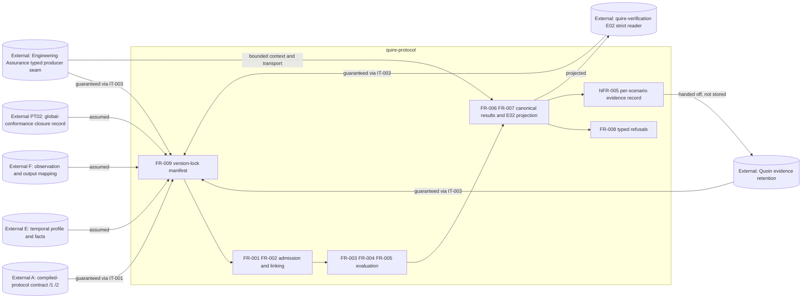

## Summary

This review judges the boundary line the packet draws for issues #12 and #13
under EPIC #14: that this repository owns a version-lock manifest and a
per-scenario evidence record while owning no producer schema, canonicalizer,
evidence store, catalogue, sufficiency decision or disposition path. The line
holds. FR-009 indexes producer identity and never restates producer meaning, and
NFR-005 constrains what a scenario carries rather than where evidence is kept or
whether it suffices, so neither requirement duplicates Quoin or Engineering
Assurance. Ten allocation defects qualify that ruling: one clause (revision
reachability) requires impure access the architecture forbids, one omission (the
digest preimage rule) leaves room for a second canonicalizer to appear inside
the manifest, IT-002 allocates the complete-global-conformance closure record
twice, and AD-001 now contradicts itself about whether any boundary records
evidence.

## Central Ruling

**The packet does not breach the program rule.** The rule is "reuse Engineering
Assurance for producer execution and Quoin for retained evidence; do not add a
local runner, transcript verdict parser, evidence store, method catalogue,
sufficiency decision, or human disposition path." Taking each in turn against
what FR-009, NFR-005 and the two owner-boundaries tables actually require:

- **Local runner** — nothing in the packet invokes a producer. IT-003-SC-01 and
  SC-07 submit typed requests *through* Engineering Assurance; FR-009 resolves
  entries before a request is submitted and reads no producer value itself. The
  one clause that edges toward impure access is FR-009's reachability test, and
  it is recorded as FND-001, not as a runner.
- **Transcript verdict parser** — IT-003's owner table forbids it explicitly
  ("Spawn a process, parse stdout, or decide a verdict from transcript text"),
  and IT-003-SC-02 asserts no transcript text determines a verdict. FR-009 goes
  further and refuses to accept a producer-emitted sidecar, display name, path
  or message text as the source or repair of an entry — the same self-authorizing
  -offer defect SR-043 identified, now closed by requirement.
- **Evidence store** — the manifest holds owners, revisions and digests, not
  artifacts; NFR-005 explicitly disclaims retention, storage and location. The
  residual ambiguity about where a scenario record lives between production and
  Quoin handoff is FND-010, and today only NFR-003-AC-4 holds that line.
- **Method catalogue** — no verification-method vocabulary is authored anywhere
  in the packet. NFR-005's Measurement table selects methods for its own metrics;
  it does not define a catalogue for others to draw from.
- **Sufficiency decision** — NFR-005-AC-3's distinctness check reads only this
  repository's own FR-008 typed-outcome identities across this repository's own
  scenarios. It decides that two refusals are not the same refusal; it does not
  decide that evidence is adequate to qualify anything. IT-003's table keeps
  sufficiency with quire-verification and Quoin and IT-003-SC-05 requires
  refusal "without an E02 success or sufficiency decision". This is inside.
- **Human disposition path** — absent. NFR-005-AC-5 reports a scenario as
  incomplete and leaves its matrix row unexecuted, which is a machine-checked
  self-report, not a disposition.

**FR-009 does not cross into a producer's authority.** An entry names an owner,
an immutable revision, a content digest and the dependent scenarios. Every one
of those is an identity, and naming a producer's version is indexing it, not
redefining it. There is no second schema (no producer payload shape is declared
anywhere in FR-009), no second vocabulary (no axis, finding, digest-domain or
premise term is restated), and — critically — FR-009 avoids the exact defect
SR-043 recorded against the version 2 intake, where B's enums restated A's contract
vocabulary with nothing reconciling them. The single qualification is FND-002:
"recompute the content digest" without a stated preimage is the one place where a
canonicalizer could grow inside the manifest, because AD-001 mandates JCS for
digest preimages while also holding that producer-owned digest domains stay
distinct typed inputs. Pin the preimage to the exact received byte sequence and
the crossing is impossible rather than merely unintended.

**NFR-005 duplicates neither Quoin nor Engineering Assurance.** Quoin owns
retention, provenance-as-kept, limitations and assurance reporting; Engineering
Assurance owns execution, transport and run/budget identity. NFR-005 owns the
*composition* of a scenario record — which manifest snapshot it ran against,
which owner each consumed value came from, which typed outcome it produced, what
budget it was granted and consumed. That composition exists nowhere else: Quoin
cannot supply it because Quoin never sees which of B's scenarios consumed which
pinned entry, and Engineering Assurance cannot supply it because it does not know
B's acceptance criteria. Two seams need repair — provenance is worded as
Quoin-supplied in IT-003 while NFR-005-AC-2 has B produce it (FND-007), and
AD-001's Views paragraph still says no boundary records evidence (FND-004) — but
both are wording defects over a correct allocation, not duplication.

**AD-001's line is the right line.** "Indexing what was consumed is inside;
producing, storing or assessing it is outside" is the sharpest statement of the
boundary this repository has, and it is the one that makes the manifest and the
evidence record defensible rather than opportunistic. Adopt it as written.

## System Context

## In-Scope Responsibilities

- Resolve every external producer through one version-lock manifest, verify each
  recorded digest against the resolved artifact, and refuse before reading any
  producer value when an entry is absent, unpinned, provisional or mismatched
  (FR-009).
- Compose, per executed integration scenario, the resolved manifest snapshot,
  the owner of every consumed producer value, the typed outcome, and the budget
  granted and consumed, bound to an acceptance criterion by a compiler-checked
  trace attribute (NFR-005).
- Keep every refusal identity distinct within one integration so that two
  different failures are never retained as the same failure (NFR-005-AC-3,
  FR-008).
- Own compensation state, finite conformance, claim dispatch, canonical result
  production, the total source-bound E02 projection, and typed refusals
  (IT-002 and IT-003 owner tables).

## Out-of-Scope Responsibilities

- Producing, canonicalizing, storing or assessing any producer artifact.
- Producer execution, process spawning, transcript reading, verdict derivation.
- Evidence retention, method catalogue, sufficiency assessment, human disposition.
- Authoring a second E02 reader, relaxing a finding, or declaring E02 sufficiency.

## External Dependencies

| Dependency | Type | Assumed or Guaranteed | Contract |
| --- | --- | --- | --- |
| A compiled-protocol version 1 | Rust artifact interface | Guaranteed | IT-001 SC-01..SC-05, manifest entry pinned at PR72 revision |
| A compiled-protocol version 2 | Rust artifact interface | Assumed (unpinnable) | IT-001 SC-06..SC-09, entry explicitly unresolved until published |
| E temporal profile and facts | Rust typed facts | Assumed | IT-002 SC-01..SC-04, entry required by FR-009 |
| F observation and output mapping | Rust typed facts | Assumed | IT-002 SC-01..SC-04, entry required by FR-009 |
| PT02 global-conformance closure record | Typed record | Assumed | IT-002 SC-03/SC-04 — **no FR-009 entry class declared (FND-005)** |
| Engineering Assurance producer seam | Typed request/result | Guaranteed | IT-003 SC-01, SC-02, SC-06, SC-07 |
| quire-verification E02 strict reader | Strict reader | Guaranteed | IT-003 SC-03, SC-05 |
| Quoin evidence interface | Structured interface | Guaranteed | IT-003 SC-04, containment per `quire-research#62` |

## Responsibility Allocation

| Requirement | Owning Component | Class |
| --- | --- | --- |
| FR-009 (version-lock manifest resolution and digest verification) | Producer resolution boundary | cross-cutting |
| NFR-005 (per-scenario evidence record composition) | Integration lanes | cross-cutting |
| FR-001, FR-002 (admission and linking) | Strict admission boundary | core |
| FR-003, FR-004, FR-005 (compensation, conformance, dispatch) | Protocol evaluator | core |
| FR-006, FR-007 (canonical results, E02 projection) | Result producer | core |
| FR-008 (typed refusals) | Refusal boundary | cross-cutting |
| NFR-002 (resource bounds) | Every boundary | cross-cutting |
| NFR-003 (Rust assurance boundary) | Repository inventory | cross-cutting |
| IT-002 SC-05..SC-08 | Observation/temporal integration lane | core |
| IT-003 SC-06..SC-09 | Assurance/E02/Quoin integration lane | core |

## Findings

| ID | Severity | Summary | Refs | Escape Cause |
| --- | --- | --- | --- | --- |
| FND-001 | high | FR-009 requires each revision be "reachable from its owner's published history", which no pure boundary can determine without VCS or network access that AD-001's Views paragraph and NFR-003 forbid; reachability must be an owner-supplied manifest input, not a check this library performs. | FR-009 Behavior, FR-009-AC-1, FR-009-AC-2, AD-001 Views, NFR-003-AC-4 | wrong-requirement |
| FND-002 | high | FR-009 requires recomputing each artifact's content digest but never states the preimage; AD-001 mandates JCS for digest preimages while holding producer-owned digest domains distinct, so an unpinned preimage lets a second canonicalizer over producer content appear inside the manifest — the exact crossing the intake section forbids. | FR-009 Behavior, FR-009-AC-3, AD-001 Decisions, AD-001 Qualification-evidence intake | missing-requirement |
| FND-003 | high | IT-002 allocates the complete-global-conformance closure record twice and contradictorily: the Objective calls it "the B-owned complete-global-conformance closure record" while the owner-boundaries table assigns it to PT02 and forbids this repository from synthesising it. | IT-002 Objective, IT-002 Owner boundaries | wrong-requirement |
| FND-004 | medium | AD-001 now contradicts itself: the Views paragraph states no boundary "records evidence", while the new intake section gives this repository a per-scenario evidence record; the intended reconciliation (lanes record, boundaries do not) is nowhere written. | AD-001 Views, AD-001 Qualification-evidence intake, NFR-005 | wrong-requirement |
| FND-005 | medium | PT02 is an owner in IT-002's table and IT-002's preconditions say every external producer resolves through the manifest, but FR-009's Inputs enumerate A, E, F, Engineering Assurance, E02 and Quoin only — PT02 has no declared entry class, so a required producer can be consumed unpinned. | FR-009 Inputs, IT-002 Preconditions, IT-002 Owner boundaries | missing-requirement |
| FND-006 | medium | IT-002's owner table omits the owners of two of its own scenarios' values: no row grants the budget SC-06 exercises and no row owns the retention SC-07's evidence record is handed to, leaving those responsibilities unallocated in the integration that exercises them. | IT-002 Owner boundaries, IT-002-SC-06, IT-002-SC-07, NFR-002, NFR-005 | missing-requirement |
| FND-007 | medium | Provenance is double-allocated: IT-003's table has Quoin *supply* provenance, while NFR-005-AC-2 has every consumed value carry its owner as produced here; retention versus production is the intended split but neither document says so. | IT-003 Owner boundaries, IT-003-SC-04, NFR-005-AC-2 | wrong-requirement |
| FND-008 | medium | NFR-005's Scope claims every scenario of IT-001, IT-002 and IT-003, but IT-001 verifies neither NFR-005 nor FR-009, has no manifest-snapshot or retention scenario, and tests.md maps both new requirements to IT-002/IT-003 only. | NFR-005 Scope, IT-001 relationships, spec/tests.md | correct-requirement-no-evidence |
| FND-009 | medium | NFR-003 constrains FR-001..FR-008 only, so the program rule's enforcing requirement does not formally bind FR-009 or NFR-005 — the two requirements that most directly approach the runner/store/sufficiency line. | NFR-003 relationships, FR-009, NFR-005 | correct-requirement-no-evidence |
| FND-010 | low | NFR-005 declines to say where a scenario record lives between composition and Quoin handoff; only NFR-003-AC-4's inventory ban currently prevents that record from being materialised as a repository-local evidence store, and NFR-005 does not cite it. | NFR-005 Scope, NFR-005 Dependencies, NFR-003-AC-4 | missing-requirement |

## Recommendations

1. Replace FR-009's reachability check with an owner-supplied reachability
   assertion carried in the entry, and state that resolution reads no VCS,
   filesystem or network (FND-001).
2. State in FR-009 that the recomputed digest is taken over the exact received
   byte sequence, unnormalised, in the producer's own published digest domain
   where one exists (FND-002).
3. Correct IT-002's Objective to name PT02 as the closure record's owner, and add
   a PT02 entry class to FR-009's Inputs (FND-003, FND-005).
4. Amend AD-001's Views paragraph to say no *library boundary* records evidence,
   distinguishing it from the lane-level scenario record (FND-004).
5. Add budget-grant and evidence-handoff rows to IT-002's owner table (FND-006),
   and reword IT-003's Quoin row from "supplies provenance" to "retains the
   provenance each scenario composes" (FND-007).
6. Extend NFR-003's constrains set to FR-009 and NFR-005, and either narrow
   NFR-005's Scope to IT-002/IT-003 or add the retention scenario to IT-001
   (FND-008, FND-009, FND-010).
