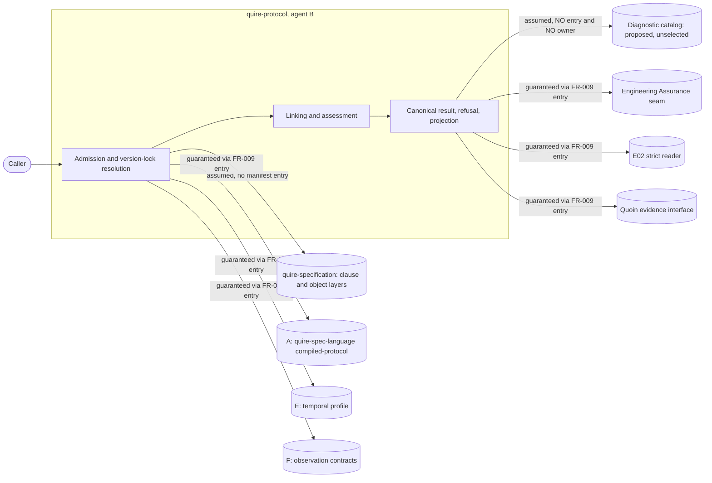

## Summary

This review judges commit `293ffce` against one question: whether adopting
`quire-specification`'s domain object layer moved the ownership line in either
direction. Eight of the nine new object requirements hold the test FR-010-AC-1
sets — they describe a consumer-to-producer relationship, not a producer's
subject. **FR-015 does not.** It declares a second closed digest-domain
vocabulary beside upstream's closed digest-domain vocabulary, which is the
"second locally authored profile" FR-001 exists to refuse, one level below
protocol semantics. The reverse failure is also present, once: the refusal
envelope's interior is handed to an upstream catalog that upstream records as
proposed, unselected and unowned, with no version-lock entry behind it.

Ten findings: two high, four medium, four low. Every upstream attribution in the
four "Where the upstream vocabulary does not yet reach" sections was checked
against the upstream artifact's own bytes at `3c913c2`; all but one were found
accurate. Every distinct `ix://agent-ix/quire-specification/FR-2NN` reference in
`spec/` resolves to a published object.

## System boundary

### In-scope responsibilities

- Retain a selection independently before any offered byte is inspected, and
  refuse an offer that supplies its own acceptance context (FR-013).
- Resolve every external producer to a pinned immutable revision through one
  B-authored manifest, and refuse every integration whose required entry is not
  pinned (FR-009, FR-012).
- Return a typed outcome identity injective over refusal axes within one
  integration (FR-014), held distinct from a resource-incomplete outcome
  (FR-016) and from a completed-and-empty result (FR-006).
- Account a caller budget per dimension, never as one scalar (FR-016).
- Compose and hand off scenario evidence without storing, cataloguing or
  disposing of it (FR-017, NFR-003).
- Index what a producer delivered, as consumer-written evidence that can neither
  supply nor repair a manifest entry (FR-018).

### External dependencies

| Dependency | Type | Assumed or Guaranteed | Contract |
| --- | --- | --- | --- |
| `quire-specification` clause layer | Formal clause source | Assumed | AGENTS.md, spec.md section 16 |
| `quire-specification` object layer | Domain vocabulary | Assumed | Resolving `ix://` references |
| A `quire-spec-language` compiled-protocol version 1, version 2 | Artifact bytes | Guaranteed | FR-009 entry, IT-001, digest |
| E temporal profile | Artifact bytes | Guaranteed | FR-009 entry, IT-002 |
| F observation and output-mapping contracts | Artifact bytes | Guaranteed | FR-009 entry, IT-002 |
| Engineering Assurance producer-execution seam | Interface | Guaranteed | FR-009 interface-only entry, IT-003 |
| E02 strict reader | Interface | Guaranteed | FR-009 interface-only entry, IT-003 |
| Quoin evidence interface | Interface | Guaranteed | FR-009 interface-only entry, NFR-005 |
| Selected versioned diagnostic catalog | Artifact bytes carried in every refusal | **Assumed, with no contract** | None — see FND-002 |

## Central ruling: FR-015 crosses, the other eight do not

FR-010-AC-1 states the test: an object belongs here if it describes the
consumer's relationship to a producer's subject rather than the subject itself.
Applied one at a time against `3c913c2`:

| Requirement | Subject | Holds? |
| --- | --- | --- |
| FR-010 | The consumer boundary itself | Yes. A bounded context naming what it does not own. |
| FR-011 | Which side authored an identity | Yes. `authority` is orthogonal to upstream's three kinds and constrains only B-specified objects. Upstream has no concept of a consumer author. |
| FR-012 | B's own manifest entry | Yes. FR-009 Inputs already fixes the entry as B-authored and never producer-supplied. |
| FR-013 | Retention before inspection | Yes, and stated: a producer has no concept of a selection retained before its bytes were inspected. |
| FR-014 | Which outcomes are the same outcome | Yes for the envelope identity. The interior is referenced, not restated — but see FND-002 and FND-003. |
| FR-015 | Digest domain membership | **No.** See below. |
| FR-016 | Caller budget dimensions | Yes, and independently confirmed. No upstream object types a caller budget dimension, and the objects that come nearest (FR-202, FR-271, FR-272) place the caller work budget outside upstream's own scope. This repository's own NFR-002 and FR-009 Bounds dimensions are carried exactly, with none invented. |
| FR-017 | B's own execution evidence | Yes. Passed, never stored. |
| FR-018 | B's index of a shipment | Yes. See the FR-224 ruling below. |

FR-015 fails because `ix://agent-ix/quire-specification/FR-201` is not, as FR-015
describes it, an artifact that merely types the domain *label kind*. It owns the
digest-domain vocabulary itself. Two of FR-015's four members re-spell members
that vocabulary already publishes:

- `native-raw`, the digest over the exact delivered bytes with no
  canonicalization, re-encoding or normalization, against the published
  `raw-artifact-digest`.
- `protocol-result`, the digest over the RFC 8785 (JCS) canonical form, against
  the published `quire.verification.jcs`. FR-201 additionally publishes the
  preimage `quire.protocol.e02-projection-identity/v1-draft.1` for the
  projection identity FR-007 produces.

FR-015 is right that FR-201 selects no member for B's digests, and right that
FR-259, FR-261 and FR-263 each record that omission and decline to close it — all
three quotations are verbatim. But "upstream selects no member for my digest"
licenses asking upstream to select one, or selecting from FR-201's published
members and saying so. It does not license minting new labels and closing
membership against upstream's. Both vocabularies make spelling load-bearing
(FR-201-AC-1, FR-015-AC-1) and both make a different label mean unequal over
identical bytes. The consequences are concrete, not stylistic:

1. A producer digest arriving labelled `raw-artifact-digest` or
   `quire.verification.jcs` has no member in FR-015's closed set. Under
   FR-015's own absence rule it is refused rather than interpreted under an
   ambient selection — so B cannot consume an upstream-labelled digest at all.
2. B's own FR-006 result digest under `protocol-result` compares unequal to the
   same bytes under `quire.verification.jcs`, which is the label the ecosystem's
   verification domain uses.
3. FR-015 already documents this failure mode one level down — two enums sharing
   one member name with no mapping between them — and its own "What must be
   decided, and is not decided here" section is the right instinct applied to
   the crate but not to upstream.

The fix is not to delete FR-015. It is to state FR-015's four members as a
*selection over FR-201's vocabulary* where FR-201 already has a member, and to
raise the remainder (`producer-canonical`, `compiled-artifact`) as a requested
addition to FR-201 alongside issues 28 and 29 — the same route this change
correctly used for every other gap it met.

## Item 4: FR-018 against upstream FR-224

Drawn clearly enough. FR-018 carries a dedicated "This is not
`ix://agent-ix/quire-specification/FR-224`" section, a five-row contrast table,
FR-018-AC-2 as an executable form of the distinction, and an explicit note in
Key order that the index order is emphatically not the binding order. The
table's characterisation of FR-224 is accurate: FR-224 establishes no identity
kind, no key and no key order, and records that gap as open. One residual
exposure is recorded as FND-010.

## Item 5: independent verdict on ADR-001's counts

Both sides were recounted from the sources rather than from the ADR.

**Upstream's claim — confirmed.** Upstream's own commit record was checked
directly and matches what ADR-001 says of it: each subsystem it split out maps
to exactly one owner, and the stated driver is that a structure already assigned
by identifier range was invisible in a flat layout. No overlap or double-claim
motive appears. A `git grep` over all of upstream's `origin/main` for `13 of
38`, `5 of 8` and `double-claim` returns nothing. **The prior brief's figures
exist nowhere upstream, and ADR-001 is right to say so.**

**B's own claim — one correct, one with a wrong denominator.** "FRs claimed by
more than one candidate subsystem: 2 of 9" is correct: FR-002 and FR-004 are the
only requirements appearing in two rows of the candidate table. "Candidate
subsystems spanning more than one owner: 0 of 9" reuses the FR denominator for a
subsystem count — the table lists **eleven** candidates, so the figure is 0 of
11. The substantive claim survives the correction: no candidate spans owners,
because every artifact under `spec/` is B-authored and the external parties enter
only through FR-009's manifest. Recorded as FND-006.

**Does the decision follow?** Yes. Upstream split because single-owner
identifier ranges were already assigned and the layout hid them; B has no such
assignment, no second owner, nine requirements, and would have empty directories
under any mirroring split. The decision to stay flat follows from the corrected
numbers as readily as from the stated ones.

## Responsibility allocation

| Requirement | Owning Component | Class |
| --- | --- | --- |
| StR-001 | quire-protocol library | core |
| FR-001 | Admission | core |
| FR-002 | Linking | core |
| FR-003 | Compensation assessment | core |
| FR-004 | Global conformance assessment | core |
| FR-005 | Claim dispatch | core |
| FR-006 | Result production | core |
| FR-007 | E02 projection | core |
| FR-008 | Refusal envelope | cross-cutting |
| FR-009 | Version-lock resolution | infrastructure |
| FR-010 | Consumer boundary (context) | core |
| FR-011 | Consumer boundary (context) | cross-cutting |
| FR-012 | Version-lock resolution | infrastructure |
| FR-013 | Admission | core |
| FR-014 | Refusal envelope | cross-cutting |
| FR-015 | Digest handling | cross-cutting |
| FR-016 | Budget accounting | cross-cutting |
| FR-017 | Evidence handoff | cross-cutting |
| FR-018 | Fixture and delivery intake | infrastructure |
| NFR-001 | Result production | core |
| NFR-002 | Budget accounting | cross-cutting |
| NFR-003 | Evidence handoff | cross-cutting |
| NFR-004 | Local gate | infrastructure |
| NFR-005 | Evidence handoff | cross-cutting |
| IT-001 | Admission | core |
| IT-002 | Global conformance assessment | core |
| IT-003 | Evidence handoff | cross-cutting |

## Findings

| ID | Severity | Summary | Refs | Escape Cause |
| --- | --- | --- | --- | --- |
| FND-001 | high | FR-015 declares a second closed digest-domain vocabulary beside upstream FR-201's closed vocabulary — `native-raw` re-spells `raw-artifact-digest` and `protocol-result` re-spells `quire.verification.jcs` — so an upstream-labelled digest has no member at B's boundary and B's own result digest is unequal to the same bytes under upstream's label. | FR-015, FR-015-AC-1, FR-015-AC-4, FR-010-AC-2, FR-001, ix://agent-ix/quire-specification/FR-201 | wrong-requirement |
| FND-002 | high | The refusal envelope's interior is bound to `FR-270`, but FR-270 records that the only catalog offered is proposed rather than adopted or implemented, and that a response naming no catalog selection has an absent selection that is never defaulted. No diagnostic-catalog owner appears in FR-009's producer list, no manifest entry exists for one, and spec.md section 16 names none — so a producer value carried in every refusal is consumed with no pin and no contract. | FR-008 Adopted vocabulary, FR-014 Properties, FR-009 Inputs, spec.md section 16, ix://agent-ix/quire-specification/FR-270 | missing-requirement |
| FND-003 | medium | FR-014 states that the catalog digest's domain selection is upstream's and not recomputed here, but FR-270 records as an open gap that no upstream artifact states which domain that is; FR-008's gap section counts the interiors carrying open gaps and omits FR-270's two, so the one interior B asserts is settled is the one upstream records as unsettled. | FR-014 Identity and comparison, FR-014-AC-8, FR-008 Where the upstream vocabulary does not yet reach, FR-010-AC-3 | wrong-requirement |
| FND-004 | medium | FR-006's settlement-basis gap bullet claims the vocabulary is stated three ways upstream, and attributes to FR-243 a sentence that appears in FR-258 instead. FR-243's own text supports two memberships, not three. | FR-006 Where the upstream vocabulary does not yet reach, ix://agent-ix/quire-specification/FR-243, ix://agent-ix/quire-specification/FR-258 | wrong-requirement |
| FND-005 | medium | FR-010-AC-2 asserts that every protocol, temporal or observation noun in this repository's requirements resolves to an `ix://...FR-2NN` reference, but adoption reached only FR-002, FR-003, FR-006 and FR-008. FR-004, FR-005, FR-007, NFR-001, IT-002 and IT-003 carry zero such references while using causal, channel, activation, compensation, closure and observation nouns. | FR-010-AC-2, FR-004 Description, FR-005, FR-007, NFR-001, IT-002, IT-003 | correct-requirement-no-evidence |
| FND-006 | medium | ADR-001 reports "Candidate subsystems spanning more than one owner: **0 of 9**" against a table listing eleven candidates, reusing the FR denominator for a subsystem count. The correct figure is 0 of 11; the decision is unaffected. | ADR-001 The equivalent measurement here | wrong-requirement |
| FND-007 | low | FR-010-AC-1..AC-3 are the three criteria that enforce the ownership line, and all three are verified by Inspection with no named artifact — the Domain Object Coverage row for FR-010 records "— (Inspection)". FND-001 is precisely the crossing FR-010-AC-1 exists to catch. | FR-010 Acceptance Criteria, spec/tests.md Domain Object Coverage | correct-requirement-no-evidence |
| FND-008 | low | The Domain Object Coverage table records "see artifact" instead of criterion identifiers for seven of nine rows, and the TC-014 row binds only FR-011-AC-1..AC-7 although FR-013, FR-014, FR-015 and FR-017 each name TC-014 or TC-001/TC-011 as their verification, so no row carries those criteria. | spec/tests.md Domain Object Coverage, TC-014 row, FR-013-AC-1, FR-015-AC-2, FR-017-AC-8 | correct-requirement-no-evidence |
| FND-009 | low | B's FR-015 and FR-018 collide numerically with upstream requirements of the same numbers, both of which govern digest domains — the same subject as B's FR-015. Bare "FR-015" and "FR-018" in prose is ambiguous across the boundary exactly where the boundary is thinnest. | FR-015, FR-018, ix://agent-ix/quire-specification/FR-015, ix://agent-ix/quire-specification/FR-018 | wrong-requirement |
| FND-010 | low | The FR-224 disambiguation lives only inside FR-018's body. FR-018's own Description says "recording what that delivery contained" and FR-009 Inputs uses the bare noun "delivery index" with no reference to FR-018, so a reader arriving from FR-009 never meets the distinction. | FR-018 Description, FR-018-AC-2, FR-009 Inputs | correct-requirement-no-evidence |

## Recommendations

1. **FND-001** — rewrite FR-015's Values table as a selection over
   `ix://agent-ix/quire-specification/FR-201`'s published members where one
   exists, and open an upstream issue requesting members for the two regimes
   FR-201 does not cover, alongside issues 28 and 29. Do not close it locally.
2. **FND-002** — either add a diagnostic-catalog owner and contract version to
   FR-009's producer list so the catalog takes a version-lock entry, or state in
   FR-008 that no catalog is selected today and mark the criteria resting on the
   interior unexecutable, as FR-012 and FR-017 already do for their populations.
3. **FND-003, FND-004** — correct the two gap citations against the upstream
   bytes, and add FR-270's two open gaps to FR-008's list.
4. **FND-005** — either extend the Adopted vocabulary treatment to FR-004,
   FR-005, FR-007, NFR-001, IT-002 and IT-003, or narrow FR-010-AC-2 to the
   requirements actually adopted and record the remainder as owed.
5. **FND-006** — correct the denominator in ADR-001 to 0 of 11.
