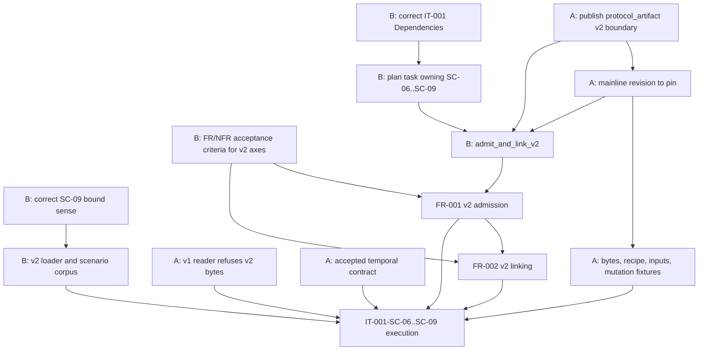

## Summary

This review separates enablement from feature work for the newly extended
version 2 consumer lane (IT-001-SC-06 through IT-001-SC-09) and
checks whether IT-001's Dependencies section names the enabling gates accurately
and completely. The version 2 lane is entirely blocked on an A-owned boundary that
does not exist on `quire-spec-language` `origin/main` at `72507f8`: there is no
`protocol_artifact::v2` module, no `ExpectedTemporal` type anywhere in the crate,
and A's published factoring places temporal evaluation in a separate top-level
`temporal` module that consumes an already-admitted `AdmittedPackage` rather than
in a `v2::read` input struct. The version 1 lane's Cargo pin `5690c2b` is not an
ancestor of `origin/main` and lives only on `origin/agent-a/handoff-numeric-domains`,
so the crate's sole non-dev dependency is already a provisional commit. Separately
from A, four defects are B-owned and fixable now: IT-001-SC-09 inverts the
resource-bound sense established by NFR-002-AC-1 while IT-001 newly declares that
it verifies NFR-002, and the B-side corpus encodes that inversion; requirement
ownership of the version 2 axes is partial, with SC-06's byte preservation, SC-07's
recanonicalized inputs and SC-07's four-domain digest substitution owned by no
acceptance criterion and `spec/tests.md` stale against the criteria that were
added; FR-001-AC-5 and FR-002-AC-5 rest on the blocked lane alone; and Plan-001
contains no task that owns the version 2 lane.

## Findings

| ID | Severity | Summary | Refs | Escape Cause |
| --- | --- | --- | --- | --- |
| FND-001 | high | `protocol_artifact::v2::{Expected, ExpectedTemporal, AdmittedPackage, read}` does not exist on A `origin/main` (`72507f8`): A exposes unversioned `protocol_artifact::{Expected, AdmittedPackage, read, Limits}` behind `WIRE = "quire.compiled-protocol/1"`, no module is named `v2`, and `ExpectedTemporal` appears nowhere; A's temporal support is a separate top-level `temporal` module (`Profile`, `Binding`, `Ledger`, its own `Limits`/`Usage`/`Exhaustion`) whose entry points take `&AdmittedPackage` after admission, so IT-001's Preconditions state a name and a shape that B does not own and that contradicts A's published factoring. | IT-001 Preconditions; IT-001-SC-06; quire-spec-language `origin/main` `src/protocol_artifact/mod.rs`, `src/temporal.rs` | wrong-requirement |
| FND-002 | high | The version 1 pin `5690c2b29c155ec72e21f5a7bb00fe1146b6f71a` in `Cargo.toml` is not an ancestor of A's `origin/main`; it exists only on `origin/agent-a/handoff-numeric-domains`, so the crate's only non-dev dependency is a provisional unmerged commit, and IT-001's Dependencies asks A only for "an immutable revision to pin" — immutability is satisfied by any branch commit, so the stated gate does not exclude the failure the version 1 lane already exhibits. | IT-001 Dependencies; IT-001 Preconditions; `Cargo.toml`; `tests/support/v2/mod.rs` `REQUIRED_A_DELIVERABLES[0]` | wrong-requirement |
| FND-003 | high | IT-001-SC-09 inverts the resource-bound sense fixed by NFR-002-AC-1, and IT-001 now declares `verifies NFR-002`, so the two are in direct contradiction: the NFR admits the exact inclusive boundary and refuses at the smallest representable *excess* unit, while SC-09 asserts that the input "one unit short of" the bound returns the typed resource refusal; `tests/support/v2/mod.rs` encodes the inversion as `LimitBound::OneShort => RefusesBeforeLinking` and `tests/it001_v2_intake.rs` asserts it, so the corpus would be rewritten once A delivers. Nothing here waits on A: A's already-published `protocol_artifact::work::{Limits, Usage, Exhaustion, Dimension}` settles the accounting sense today. | IT-001-SC-09; IT-001 frontmatter `verifies NFR-002`; NFR-002-AC-1; `tests/support/v2/mod.rs` `LimitBound`, `resource_scenarios`; `tests/it001_v2_intake.rs` `every_declared_limit_gets_an_exact_a_one_short_and_a_fresh_retry_probe` | wrong-requirement |
| FND-004 | high | SC-06 requires that version 2 bytes submitted at `admit_and_link` return a typed refusal with no auto-detection, but discriminating a version 2 wire tag inside version 1 bytes is a decode-time act that only the version 1 reader can perform, and B owns no wire decoder; A's obligation to make its version 1 `read` refuse a version 2 artifact is absent from the six deliverables IT-001's Dependencies enumerates and from `REQUIRED_A_DELIVERABLES`, so the lane names an outcome with no owning gate. | IT-001-SC-06; IT-001 Dependencies; `tests/support/v2/mod.rs` `CrossVersion::V2BytesAtV1Entry`; A `src/protocol_artifact/intake.rs::read` | missing-requirement |
| FND-005 | medium | SC-08's temporal-binding axes (profile, clock alternative, clock parameters, owner, ordinal, declared range) silently take a dependency on acceptance of A's temporal contract — the same accepted temporal profile that Task-010 records as one of its blockers — yet IT-001's Dependencies asks A only for a "selection recipe" for `v2::ExpectedTemporal` and never names temporal-contract acceptance as a gate. | IT-001-SC-08; IT-001 Dependencies; Task-010 Notes; A `src/temporal.rs` `Profile`, `Binding` | missing-requirement |
| FND-006 | high | Requirement ownership of the version 2 axes is now partial, not complete. FR-001-AC-5 owns cross-version isolation (SC-06) and FR-002-AC-5 owns the temporal selections and binding sets (SC-08), but no criterion owns SC-06's byte-and-reference preservation through linking, SC-07's recanonicalized producer inputs, or SC-07's four-domain digest substitution — FR-001-AC-4 covers only producer/result digest substitution, and IT-001's Traceability credits the four version 2 domains to NFR-002, whose AC-1..AC-4 are about resource bounds, deadlines, source-site inventory and action doubles and name no digest domain at all. `spec/tests.md` is also stale against the new criteria: the FR-001 and FR-002 rows stop at AC-4, the NFR-002 row lists only TC-009, and the IT-001 row lists only FR-001 and FR-002. None of this waits on A. | IT-001 Traceability; IT-001-SC-06, SC-07; FR-001-AC-4, FR-001-AC-5; FR-002-AC-5; NFR-002-AC-1..AC-4; `spec/tests.md` rows FR-001, FR-002, NFR-002, IT-001 | missing-requirement |
| FND-010 | medium | FR-001-AC-5 and FR-002-AC-5 are both verified by `Test (IT-001)` alone, with no TC companion, so two acceptance criteria on FR-001 and FR-002 now rest entirely on the version 2 lane that cannot execute until A publishes its boundary. Completion of FR-001 and FR-002 is thereby hard-gated on `quire-spec-language#40` with no B-runnable evidence path, where every other criterion on both requirements has a unit-level TC. | FR-001-AC-5; FR-002-AC-5; FR-001-AC-1..AC-4 (TC-001); FR-002-AC-1..AC-4 (TC-002); IT-001 Dependencies | correct-requirement-no-evidence |
| FND-007 | medium | Plan-001 contains no task that owns the version 2 lane: Task-009's subtasks stop at "Implement IT-001 SC-01 through SC-05", its Deliverables and Notes name only the `quire.compiled-protocol/1` contract and the PR72 candidate, and Task-010 owns IT-002 rather than IT-001's temporal scenarios. The version 2 corpus and loader are therefore already-written work with no owning task, and no task records the version 2 pin, rederivation, or entry-point obligations. | Task-009 Subtasks, Deliverables, Notes; Task-010; IT-001-SC-06..SC-09 | missing-requirement |
| FND-008 | medium | IT-001's Dependencies lists A's six version 2 deliverables as an unordered set, but they form a strict chain: the public names, constructors, limits, report and refusal types must be fixed before a revision pin is meaningful, the pin before the raw bytes and external reference are stable evidence, and both before the selection recipe, the unrecanonicalized input corpus, and the per-axis mutation fixtures with documented refusal expectations can be authored. Without that ordering the section can read as satisfied while the boundary is still moving, and `quire_protocol::admit_and_link_v2` — which does not exist in `src/` and whose signature cannot be written before A's types — has no stated position in the sequence. | IT-001 Dependencies; IT-001-SC-06; `src/lib.rs` (`admit_and_link` only); `tests/it001_v2_intake.rs` `v2_lane_is_blocked_on_a_s_published_boundary` | missing-requirement |
| FND-009 | low | `REQUIRED_A_DELIVERABLES` in `tests/support/v2/mod.rs` restates IT-001's Dependencies prose as a Rust constant with no trace binding to the spec text, so the two can drift apart silently; the blocked-lane test asserts nothing about the list's agreement with IT-001. | `tests/support/v2/mod.rs` `REQUIRED_A_DELIVERABLES`; IT-001 Dependencies | correct-requirement-no-evidence |

## Classification

| Requirement | Class | Rationale |
| --- | --- | --- |
| A version 2 boundary publication (`quire-spec-language#40`) | Enablement (external, A-owned) | Public names, constructors, limits, report and refusal types; no B behaviour exists without them, and none of it is on `origin/main` today (FND-001). |
| A version 2 mainline revision pin | Enablement (external, A-owned) | The revision B builds against; must be reachable from A's accepted mainline, not a feature branch (FND-002). |
| A version 2 delivery corpus | Enablement (external, A-owned) | Raw bytes and external artifact reference, selection recipe, unrecanonicalized producer inputs, per-axis mutation fixtures with documented refusal expectations. |
| A version 1 reader refuses version 2 bytes | Enablement (external, A-owned) | Decode-time discrimination B cannot perform; prerequisite to SC-06's cross-version half (FND-004). |
| A temporal contract acceptance | Enablement (external, A-owned) | Frozen profile, clock alternative and clock parameter vocabulary underlying SC-08 (FND-005). |
| FR/NFR acceptance criteria for the remaining version 2 axes | Enablement (B-owned, available now) | FR-001-AC-5 and FR-002-AC-5 now own cross-version isolation and temporal bindings; byte-and-reference preservation, recanonicalized producer inputs and four-domain digest substitution remain unowned, and the Test Matrix is stale against the criteria already added (FND-006, FND-010). |
| IT-001-SC-09 bound-sense correction | Enablement (B-owned, available now) | Reconciles SC-09 and the B-side corpus with NFR-002-AC-1 before the lane is written against A (FND-003). |
| IT-001 Dependencies correction | Enablement (B-owned, available now) | Adds the mainline-acceptance gate, the version 1-refuses-version 2 obligation, temporal-contract acceptance, and the ordering among A's deliverables (FND-002, FND-004, FND-005, FND-008). |
| Plan task owning SC-06..SC-09 | Enablement (B-owned, available now) | Places the version 2 lane, its pin and its entry point under a tracked task (FND-007). |
| B version 2 evidence loader and scenario corpus | Enablement (B-owned, complete) | `tests/support/v2/mod.rs` and `tests/it001_v2_intake.rs`; names no A type, adds no `[features]` entry or `cfg`, and reports absence rather than skipping. |
| FR-001 (version 2 admission behaviour) | Feature | Version-explicit admission through `admit_and_link_v2`; depends on every enablement row above. |
| FR-002 (version 2 linking behaviour) | Feature | Linking the version 2 admitted package; depends on FR-001. |
| IT-001-SC-06..SC-09 execution | Feature | The lane's actual assertions about A's behaviour; last in the order and currently unexecuted by design. |

## Dependency Graph

## Topological Order

1. B-owned, runnable now with no A input: correct IT-001-SC-09's bound sense and
   the corpus rows that encode it; correct IT-001's Dependencies to require a
   revision reachable from A's accepted mainline, to name the version 1-refuses-version 2
   obligation and temporal-contract acceptance, and to order A's deliverables;
   author the acceptance criteria that still own no version 2 axis and refresh
   `spec/tests.md` against FR-001-AC-5, FR-002-AC-5 and IT-001's NFR-002
   relationship; open the plan task that owns SC-06..SC-09.
2. A-owned enablement: publish the version 2 boundary with its public names,
   constructors, limits, report and refusal types; merge it to mainline and
   name the revision; emit the bytes, external reference, selection recipe,
   unrecanonicalized producer corpus, and per-axis mutation fixtures with
   documented refusal expectations; make the version 1 reader refuse version 2 bytes;
   accept the temporal contract.
3. B feature work: pin the mainline revision, write `admit_and_link_v2` against
   A's types, rederive the selection, and run the SC-06..SC-09 scenarios the
   delivery owes.

## Cycles

None detected. Every edge is an explicit prerequisite; the version 1 and version 2 lanes
share IT-001 but neither is a prerequisite of the other, and `admit_and_link`
keeps its version 1 behaviour independently of the version 2 entry point.
