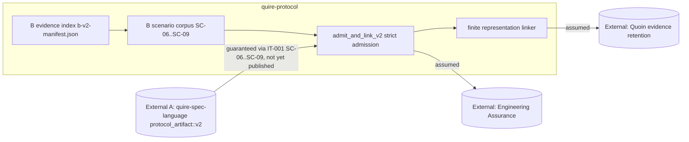

## Summary

This review allocates ownership for the newly extended version-explicit `/2`
consumer scenarios IT-001-SC-06 through IT-001-SC-09 and the B-side code written
ahead of A's delivery, and answers the central question plainly: B's
`b-v2-manifest.json` evidence index and its scenario enums are legitimately
B-owned qualification evidence, not a second schema, a second wire decoder, or a
second copy of A's compiled-protocol contract. The offered `/2` bytes are read as
an opaque `Vec<u8>` and never interpreted, so no parser or canonicalizer crosses
into `quire-spec-language` territory. Two real boundary defects remain: B's axis,
digest-domain and producer-input enums restate A's contract vocabulary with
nothing reconciling them against A's published `/2` contract once it lands, and
no requirement in this repository owns the evidence-index schema at all.

## System Context

## In-Scope Responsibilities

- Retain, independently of the offer, every `/2` selection input and index where
  those retained bytes live, byte for byte and without recanonicalization.
- Construct `v2::Expected` and `v2::ExpectedTemporal` from B-retained selections
  only, never from the offered bytes.
- Enumerate, and prove complete, the one-axis mutation corpus SC-06 through
  SC-09 owes: changed selection, cross-version submission, digest-domain
  substitution, recanonicalized producer input, temporal-binding mutation, and
  exact/one-short/fresh-retry resource probes.
- Submit the exact offered bytes through `quire_protocol::admit_and_link_v2` and
  assert the typed disposition A returns.
- Report every absence of A-owned evidence loudly rather than skipping.

## External Dependencies

| Dependency | Type | Assumed or Guaranteed | Contract |
| --- | --- | --- | --- |
| A `protocol_artifact::v2::{Expected, ExpectedTemporal, AdmittedPackage, read}` | Rust API | Guaranteed | IT-001-SC-06..SC-09; not published, no revision pinnable |
| A `/2` emitted bytes and external artifact reference | Opaque bytes | Guaranteed | IT-001-SC-06 byte-preservation check |
| A `/2` declared limit set | Contract values | Guaranteed | IT-001-SC-09, indexed as `IndexedLimit` |
| A `/2` per-axis mutation fixtures and refusal expectations | Fixture corpus | Guaranteed | IT-001-SC-06..SC-08 |
| A `quire.compiled-protocol/1` reader | Rust API | Guaranteed | IT-001-SC-01..SC-05, unchanged |
| Engineering Assurance producer execution | Typed transport | Assumed | NFR-003-AC-4, IT-003 |
| Quoin evidence retention | Structured interface | Assumed | NFR-003-AC-6, IT-003 |
| `ix_trace_rs::trace` bindings | Rust macro | Guaranteed | NFR-003-AC-5 |

## Responsibility Allocation

| Requirement | Owning Component | Class |
| --- | --- | --- |
| FR-001 (strict `/2` admission, digest domains, numeric wire profile) | quire-protocol admission boundary | core |
| FR-002 (finite representation linking after admission) | quire-protocol linker | core |
| NFR-003 (Rust-only first-party paths, no local evidence store) | quire-protocol repository | cross-cutting |
| IT-001-SC-06 (version-explicit entry points, no auto-detection) | quire-protocol `/2` intake lane | core |
| IT-001-SC-07 (digest-domain separation, no recanonicalization) | quire-protocol `/2` intake lane | core |
| IT-001-SC-08 (temporal binding set integrity) | quire-protocol `/2` intake lane | core |
| IT-001-SC-09 (declared resource limits, no carried state) | quire-protocol `/2` intake lane | infrastructure |
| NFR-002 (resource bounds, now verified by IT-001) | quire-protocol `/2` intake lane | infrastructure |
| AD-001 (ownership and data-flow boundaries) | quire-protocol architecture | cross-cutting |
| Task-009 (native compiler integration harness) | quire-protocol test harness | infrastructure |
| `b-v2-manifest.json` evidence index and loader | quire-protocol test harness | infrastructure |
| `/2` compiled-protocol contract, wire shape, reader, canonicalization | quire-spec-language (A, issue 40) | external |

## Ruling on the evidence index

`b-v2-manifest.json` and its serde types are legitimately B-owned evidence
indexing, not A-owned territory. The index describes only which B-retained
files exist and where they live, the offered `/2` bytes are read as an opaque
byte vector and carried through unmodified, and no code in
`tests/support/v2/mod.rs` interprets A's wire shape. There is no second schema
of A's contract, no second wire decoder, and no parser. The only part that
approaches A-owned vocabulary is the enum set, and that is recorded as FND-001
below rather than as a boundary violation today.

## Findings

| ID | Severity | Summary | Refs | Escape Cause |
| --- | --- | --- | --- | --- |
| FND-001 | medium | `SelectionAxis::ALL` (11), `DigestDomain::ALL` (4), `ProducerInput::ALL` (4) and `TemporalBindingMutation::ALL` (6) are a B-local restatement of A's contract vocabulary, and nothing reconciles them against A's published `/2` contract. The corpus tests assert these lists against themselves, so if A declares a different axis set the lane reports a complete corpus that is silently incomplete. This is where the evidence index gets closest to a second vocabulary of A's contract, and it is the one place a pin-time check is required. | tests/support/v2/mod.rs; IT-001-SC-06..SC-08; FR-001-AC-2 | correct-requirement-no-evidence |
| FND-002 | medium | No requirement in this repository owns the evidence-index schema. `b-v2-manifest.json` is a first-party artifact with a `deny_unknown_fields` shape, kebab-case role vocabulary and a `producer_revision` field, yet FR-001, IT-001, AD-001 and Task-009 name none of it. NFR-003 scopes fixture audits and adapters but allocates no owner, so nothing constrains the index from growing fields that restate A-derived values. | tests/support/v2/mod.rs; AD-001; NFR-003; Task-009 | missing-requirement |
| FND-003 | medium | IT-001's `/2` Inputs section declares retained `result` and `configuration` selections, but SC-06's changed-selection axis list omits both. `configuration` is reachable only indirectly through SC-07's recanonicalization probe and `result` has no one-axis mutation at all, so `SelectionRole` carries two roles that `SelectionAxis` cannot mutate. | IT-001 Inputs; IT-001-SC-06; FR-001-AC-2 | wrong-requirement |
| FND-004 | medium | AD-001's System Boundary allocates admission, linking, evaluation and refusal but never allocates qualification-evidence intake, which is now a real B-owned subsystem with a schema, a loader, an absence taxonomy and a scenario corpus. The architecture description does not say that B owns evidence indexing while A owns the artifact contract, which is exactly the distinction FND-001 rests on. | AD-001; tests/it001_v2_intake.rs; NFR-003 | missing-requirement |
| FND-005 | low | `Fixture::input_bytes` and `Fixture::mutation_bytes` collapse a read failure into `None`, which is the one place the module treats a missing A-owned input as an ordinary absent value rather than a reported `Absence`. The loader's own tests catch it today, but the accessors invite a future caller to skip unreadable producer evidence instead of failing. | tests/support/v2/mod.rs; IT-001-SC-06; NFR-003 | correct-requirement-no-evidence |
| FND-006 | low | `producer_revision` is an unconstrained `String` in B's index and is not tied to a pinned A dependency. Nothing in the loader rejects a provisional or mutable revision, so the guard against pinning a provisional A commit rests entirely on the single `#[ignore]` lane test rather than on the intake boundary itself. | tests/support/v2/mod.rs; tests/it001_v2_intake.rs; Task-009; IT-001 Dependencies | correct-requirement-no-evidence |

## Recommendations

- At pin time, derive `SelectionAxis`, `DigestDomain`, `ProducerInput` and the
  temporal-binding mutation set from A's published `/2` contract and assert the
  B-side enums against it, so FND-002 fails loudly instead of silently.
- Give the evidence index an owning obligation: extend AD-001's System Boundary
  and IT-001's `/2` section to state that B owns evidence indexing and A owns
  the artifact contract, and name `b-v2-manifest.json` there.
- Add a `result` changed-selection axis, or state in IT-001 why the retained
  result selection carries no one-axis mutation.
- Return a reported `Absence` from the two byte accessors rather than `None`,
  and reject a `producer_revision` that is not an immutable pinned A revision.
